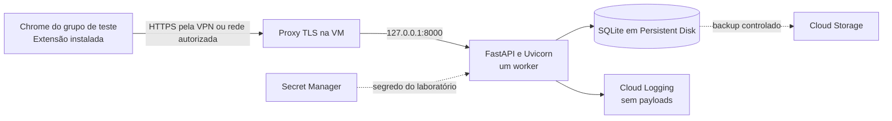

# Plano de infraestrutura do MVP no Google Cloud

**Status:** proposta para revisão. Este documento não aprova uso de dados reais nem autoriza custos ou implantação.

## Objetivo

Hospedar o backend e o banco do MVP em uma única máquina virtual do Google Cloud para um grupo interno controlado. A extensão continua instalada nos navegadores dos participantes e envia eventos à API por HTTPS.

O piloto usa somente contas e conteúdo sintéticos. O backend atual grava prompts e respostas no SQLite e mantém retenção configurável de sete dias. [O README do backend](../backend/README.md) descreve esses limites e o processo atual de um único worker.

## Arquitetura proposta

Use uma VM do Compute Engine e um Persistent Disk conectado à mesma VM. O processo da API e o arquivo SQLite permanecem no mesmo host. Não compartilhe o arquivo por NFS, Cloud Storage ou outro filesystem de rede. SQLite permite um escritor por arquivo, e seu modo WAL exige que os processos acessem o banco no mesmo host. [Orientações do SQLite](https://www.sqlite.org/whentouse.html) e [limitações do modo WAL](https://www3.sqlite.org/wal.html).

## Componentes

| Componente | Proposta | Limite do MVP |
|---|---|---|
| Projeto GCP | Projeto dedicado ao laboratório, separado de projetos corporativos e de produção. | Um ambiente `lab`; sem ambientes redundantes. |
| Região | Preferir `southamerica-east1` (Osasco, São Paulo) se a equipe, a política interna e a conta permitirem. | Região e localização dos dados precisam de aceite da empresa. [Regiões do Compute Engine](https://docs.cloud.google.com/compute/docs/regions-zones). |
| Compute Engine | VM Linux LTS com tamanho definido após estimar participantes e volume. | Uma VM não preemptiva; sem autoscaling ou alta disponibilidade. |
| Persistent Disk | Disco de dados separado do ciclo de vida da VM, montado em diretório dedicado. | Um único host acessa o banco. O tipo e o tamanho ficam para o cálculo de custo. |
| Backend | Python 3.11+, FastAPI e Uvicorn, executados por `systemd`. | Um worker. A aplicação escuta apenas em `127.0.0.1:8000`. |
| Proxy HTTPS | Caddy ou Nginx termina TLS e encaminha para a API local. | O acesso à API fica restrito à VPN ou à faixa de rede aprovada. |
| Segredos | Secret Manager fornece ao backend o segredo do cliente OAuth por uma conta de serviço com acesso mínimo. | Nenhum segredo OAuth entra na extensão; os tokens compartilhados servem apenas ao modo local. |
| Logs | Cloud Logging recebe logs técnicos sem corpo de requisição, prompts, respostas, cookies ou tokens. | Não enviar payloads ao sistema de logs. |
| Backup | Rotina gera cópia consistente do SQLite e armazena em bucket separado. | Retenção e eliminação das cópias precisam de decisão humana antes do uso. |
| Extensão | Pacote instalado nos navegadores do grupo por procedimento controlado. | Não hospedar código executável da extensão no backend. |

O Compute Engine mantém discos persistentes separados da VM. Isso permite manter o disco de dados ao recriar a máquina, desde que a política de exclusão do disco esteja configurada corretamente. [Discos persistentes no Compute Engine](https://docs.cloud.google.com/compute/docs/disks/persistent-disks).

## Acesso e segurança

1. Crie o projeto GCP do laboratório e dê acesso administrativo somente às pessoas responsáveis pela implantação.
2. Restrinja a porta HTTPS aos usuários conectados à VPN corporativa ou a uma rede de saída aprovada. Não exponha a porta `8000` nem o banco à internet.
3. Restrinja SSH ao caminho administrativo aprovado pela equipe de infraestrutura. Não use regras de firewall abertas a `0.0.0.0/0` para administração.
4. Reserve um nome DNS para a API e configure um certificado TLS válido para esse nome. Mantenha Uvicorn ligado ao loopback da VM.
5. Dê à conta de serviço da VM somente permissão para ler o segredo do laboratório e gravar backups, se a rotina de backup precisar dessa permissão.
6. Mantenha o segredo OAuth fora do pacote da extensão, do repositório, dos logs e das imagens de máquina.
7. No piloto, use login individual Google Workspace. Configure no servidor o `sub` aprovado do único operador e o código oficial do setor Contábil para limitar as consultas.

No modo `lab`, a API valida o ID token Google e vincula o `sub` à chave da instalação. A assinatura comprova a chave do perfil do navegador, não a posse física do computador. O operador autorizado consulta somente os registros do setor piloto. O login deve usar conta individual; `contabil@...`, por ser compartilhada, não permite atribuir ações a uma pessoa. O endpoint HTTPS, o cliente OAuth e a lista aprovada de participantes ainda dependem da TI e do responsável pelo piloto.

Para este piloto, configure `PILOT_DEPARTMENT_CODE=FgXMby6awkvcKxQjk04Yr4sAz2mSdMTZ`, código do Contábil na linha 8 da [planilha corporativa de departamentos](https://docs.google.com/spreadsheets/d/1i06KE4iG0AYKDll_vZETnJNwHp5fPrrfCX4eTAalQsk/edit). Não importe a lista de funcionários para o repositório.

## Ajustes necessários na aplicação

1. Substitua a URL fixa `http://127.0.0.1:8000` da extensão por uma configuração de ambiente HTTPS para o endereço aprovado da API.
2. Atualize `host_permissions` no manifesto da extensão para autorizar esse domínio HTTPS. Preserve a configuração local usada no desenvolvimento.
3. Configure `DATABASE_PATH` para o diretório montado no Persistent Disk. Mantenha o arquivo e os auxiliares do SQLite fora do sistema de arquivos temporário.
4. Configure `APP_ENV=lab`, cliente e segredo OAuth, URI de redirecionamento, `GOOGLE_OPERATOR_SUB`, `PILOT_DEPARTMENT_CODE`, os limites de payload e `RETENTION_DAYS` por mecanismo protegido no host. Os tokens compartilhados ficam restritos ao desenvolvimento local.
5. Mantenha CORS vazio enquanto a extensão chamar a API pelo service worker, conforme o README atual. Confirme as permissões de host da extensão no teste de integração.
6. Mantenha a API em um único worker. Não aumente réplicas antes de migrar o banco para um servidor cliente-servidor.
7. Confirme o `sub` da conta individual do operador e os vínculos dos participantes com o cadastro oficial antes de atribuir instalações. Revogue instalações quando o vínculo deixar de valer.

Os pontos atuais da URL e das permissões estão em [`service-worker.js`](../extension/src/background/service-worker.js) e [`manifest.json`](../extension/manifest.json). O caminho do banco e as configurações ficam em [`settings.py`](../backend/app/settings.py).

## Etapas de implantação

1. **Feche as decisões de acesso e custo.** Confirme o projeto e a conta de faturamento, a região, o grupo de teste, a VPN ou rede permitida e o orçamento mensal aprovado.
2. **Prepare a extensão.** Defina um ID estável, registre o redirecionamento OAuth correspondente, configure a URL HTTPS e a permissão exata do host da API. Gere o pacote de laboratório e defina como a equipe distribuirá a extensão aos participantes.
3. **Crie os recursos GCP.** Crie a VM, a conta de serviço, as regras de firewall e o Persistent Disk. Configure alertas de orçamento antes de iniciar a VM.
4. **Configure o host.** Instale as dependências fixadas, crie o usuário sem privilégios, monte o disco de dados e configure `systemd` e o proxy TLS.
5. **Configure a API.** Carregue o segredo OAuth, o `sub` do operador e o código do setor piloto; inicialize o SQLite no disco persistente e inicie um único worker ligado a `127.0.0.1:8000`.
6. **Configure backup e restauração.** Gere um backup por método consistente com SQLite. Restaure uma cópia em ambiente temporário e confirme que o serviço volta a consultar os registros sintéticos.
7. **Execute o piloto.** Cadastre e atribua instalações a contas individuais. Teste login, captura, consulta limitada ao Contábil, token vencido, troca de conta, revogação, retenção, indisponibilidade e reinício da VM com dados sintéticos.
8. **Encerre o laboratório.** Revogue o token, pare a VM e elimine o banco, o disco e as cópias de backup conforme a decisão aprovada de retenção.

## Critérios para iniciar o piloto

- O grupo acessa a API somente pela rede aprovada e recebe resposta HTTPS válida.
- O backend aceita a extensão de laboratório e persiste eventos sintéticos após reinício do processo e da VM.
- O banco não fica acessível pela rede.
- Só o `sub` aprovado do operador consulta registros do Contábil; uma conta participante, externa ou compartilhada não recebe acesso de operador.
- A API aceita captura somente com sessão Google válida, vínculo individual aprovado e assinatura da instalação; a revogação é recusada no servidor e a extensão se desativa ao receber a recusa.
- Prompts, respostas, tokens e cookies não aparecem nos logs.
- Um backup sintético foi restaurado com sucesso.
- A retenção aprovada foi aplicada ao banco e às cópias de backup.
- O custo estimado, o orçamento e os responsáveis operacionais foram aprovados.
- O responsável pelo experimento confirmou o escopo de dados e os participantes.

## Custos e oferta gratuita

Não trate o nível gratuito como premissa do MVP. A oferta do Compute Engine inclui uma VM `e2-micro` somente em três regiões dos EUA, além de limites mensais de disco e saída de dados. A região de São Paulo não está nessa lista. Novos clientes elegíveis podem receber US$ 300 por 90 dias. Confirme a elegibilidade da conta da empresa. Durante o teste, o Google não cobra o uso. Sem upgrade ao fim do período, os recursos param e podem ser excluídos após o prazo de recuperação. Após o upgrade, o uso acima dos créditos e dos limites gratuitos pode gerar cobrança. [Limites e condições do Google Cloud Free Program](https://docs.cloud.google.com/free/docs/free-cloud-features).

Crie alertas de orçamento no projeto do laboratório. Alertas comuns notificam, mas não bloqueiam gastos automaticamente. [Orçamentos do Cloud Billing](https://docs.cloud.google.com/billing/docs/how-to/budgets).

## Evolução para PostgreSQL

Reavalie SQLite se o MVP precisar de mais de uma instância da API, alta disponibilidade, concorrência sustentada de escrita ou backups gerenciados com recuperação mais simples. Nesse caso, migre a camada de persistência para PostgreSQL gerenciado, valide o esquema e os fluxos idempotentes, e só então considere Cloud Run ou várias réplicas.

Cloud Run não é a escolha inicial para o código atual. Seu filesystem gravável é temporário, e o serviço é indicado para aplicações que não exigem filesystem local persistente e que aceitam várias instâncias. [Contrato de execução do Cloud Run](https://docs.cloud.google.com/run/docs/container-contract) e [critérios de adequação](https://docs.cloud.google.com/run/docs/fit-for-run).

## Decisões pendentes

- `POLICY_QUESTION`: quem aprova e confere os vínculos entre `sub`, funcionário e departamento no cadastro oficial? Não atribua a conta compartilhada `contabil@...` a uma pessoa.
- `POLICY_QUESTION`: o operador terá acesso ao texto bruto de prompts e respostas do Contábil, ou apenas a metadados? O endpoint de detalhe expõe texto bruto quando autorizado.
- A TI precisa fornecer o cliente OAuth, segredo, URI de redirecionamento para o ID estável da extensão e o endereço HTTPS da API. O operador precisa obter seu `sub` pelo login individual.
- Definir e testar o cliente usado pelo operador para consultar a API com seu ID token; ainda não há interface administrativa dedicada.
- `POLICY_QUESTION`: o prazo de retenção de sete dias também vale para snapshots e backups? Até a decisão, mantenha os backups limitados a dados sintéticos e apague-os ao encerrar o piloto.
- Qual projeto e conta de faturamento da empresa serão usados?
- A região será São Paulo? A equipe de segurança ou governança tem requisito de localização de dados?
- A empresa já oferece VPN para os participantes? Se não, qual mecanismo privado será aprovado para alcançar a API?
- Quantas pessoas participarão e qual orçamento mensal máximo foi aprovado?
- Quem será responsável por administração, backups, restauração, expurgo e encerramento do laboratório?

Este plano não altera políticas. A política atual da POC limita os testes a contas e conteúdo de laboratório; o uso de dados reais exige decisão explícita dos responsáveis.
